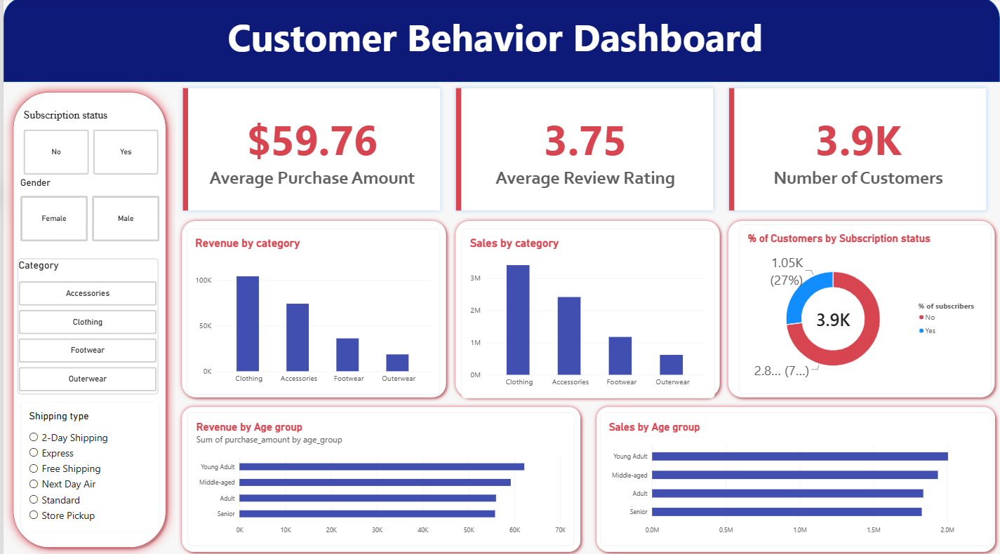

# Customer Shopping Behavior Analysis

An end-to-end data analytics project focused on understanding customer shopping patterns, purchasing behavior, product performance, discount usage, subscription trends, and revenue using **Python, MySQL, and Power BI**.

The project analyzes **3,900 purchase records across 18 columns** to uncover business insights and support data-driven decision-making.

---

## 📌 Project Overview

Understanding customer purchasing behavior helps businesses evaluate product performance, customer preferences, and revenue trends. This project uses data cleaning, SQL-based analysis, and business intelligence reporting to explore customer shopping behavior.

### 🎯 Objectives

- Clean and prepare customer shopping data for analysis.
- Analyze revenue across customer demographics and age groups.
- Evaluate subscription status and purchasing patterns.
- Identify products with high average ratings and discount usage.
- Examine customer segments and repeat-purchase behavior.
- Compare average purchase amounts across shipping types.
- Present key findings through a Power BI dashboard.
- Provide actionable business recommendations.

## 🛠️ Tools and Technologies

| Tool | Purpose |
|---|---|
| **Python** | Data cleaning, preprocessing, feature creation, and missing-value handling using pandas |
| **MySQL** | SQL queries and analysis of customer behavior, revenue, products, discounts, and subscriptions |
| **Power BI** | Dashboard reporting and data visualization |

## 📂 Dataset Overview

The dataset contains **3,900 purchase records and 18 columns** covering customer demographics, purchase details, and shopping behavior.

### Key Features

- **Customer Information:** Age, Gender, Location, Subscription Status
- **Purchase Details:** Item Purchased, Category, Purchase Amount (USD), Season, Size, Color
- **Shopping Behavior:** Discount Applied, Previous Purchases, Purchase Frequency
- **Customer Feedback:** Review Rating
- **Shipping Information:** Shipping Type

### Data Preparation

1. Imported the dataset using pandas.
2. Standardized column names to `snake_case`.
3. Created an `age_group` column.
4. Created a `purchase_frequency_days` column.
5. Imputed **37 missing review ratings** using the median rating within each category.
6. Dropped the `Promo Code Used` column.
7. Connected the prepared dataset to MySQL for SQL analysis.

## 🔍 Analysis Performed

### 1. Revenue Analysis
- Compared revenue by gender.
- Analyzed revenue across different age groups.
- Examined average purchase amounts and overall revenue metrics.

### 2. Subscription Analysis
- Compared subscribers and non-subscribers by customer count, average spending, and total revenue.

### 3. Discount Analysis
- Identified high-spending records involving discounts.
- Ranked products based on discount usage.
- Examined discount patterns to identify opportunities for reviewing discount policies.

### 4. Product Performance
- Identified the top five products by average review rating.
- Compared product counts across categories.
- Examined repeat-purchase patterns.

### 5. Shipping Analysis
- Compared average purchase amounts for standard and express shipping.

### 6. Customer Segmentation
- Analyzed **Loyal, Returning, and New** customer segments.

## 📊 Key Findings

All monetary values are reported in USD, as documented in the project report.

### Overall Metrics

| Metric | Value |
|---|---:|
| Total purchase records | 3,900 |
| Average purchase amount | $59.76 |
| Average review rating | 3.75 |
| Subscription status — Yes | 27% |
| Subscription status — No | 73% |

### Revenue by Gender

| Gender | Revenue |
|---|---:|
| Female | $75,191 |
| Male | $157,890 |

### Subscribers vs. Non-Subscribers

| Metric | Subscribers | Non-Subscribers |
|---|---:|---:|
| Customers | 1,053 | 2,847 |
| Average spend | $59.49 | $59.87 |
| Total revenue | $62,645.00 | $170,436.00 |

**Key Insight:** The average purchase amount is similar for subscribers ($59.49) and non-subscribers ($59.87), with non-subscribers recording a slightly higher average of $0.38 per purchase.

**Business Implication:** Subscription status alone does not appear to distinguish customers by average purchase amount in this dataset. Further analysis of purchase frequency, retention, and subscription benefits would help assess the value of the subscription program.

**Limitation:** This is a descriptive comparison and does not establish whether subscription status affects customer spending.

### Top 5 Products by Average Rating

| Product | Average Rating |
|---|---:|
| Gloves | 3.86 |
| Sandals | 3.84 |
| Boots | 3.82 |
| Hat | 3.80 |
| Skirt | 3.78 |

### Average Purchase Amount by Shipping Type

| Shipping Type | Average Purchase Amount |
|---|---:|
| Standard Shipping | $58.46 |
| Express Shipping | $60.48 |

### Products with the Highest Discount Usage

| Product | Purchases Using Discounts |
|---|---:|
| Hat | 50.00% |
| Sneakers | 49.66% |
| Coat | 49.07% |
| Sweater | 48.17% |
| Pants | 47.37% |

### Purchase Record Segmentation

| Segment | Customers |
|---|---:|
| Loyal | 3,116 |
| Returning | 701 |
| New | 83 |

**Note:** The segments are defined using the `Previous Purchases` field and predefined thresholds. These counts represent purchase records assigned to each rule-based segment, not necessarily unique customers. The segment labels and thresholds are analytical assumptions and should not be interpreted as verified measures of customer loyalty.

### Revenue by Age Group

| Age Group | Revenue |
|---|---:|
| Young Adult | $62,143 |
| Middle-aged | $59,197 |
| Adult | $55,978 |
| Senior | $55,763 |

### Previous Purchase Count Analysis

- 958 purchase records have a `Previous Purchases` value greater than five.
- 2,518 purchase records have a `Previous Purchases` value of five or less.
- 
## 📈 Power BI Dashboard



The Power BI report presents key metrics and analytical findings, including:

- Revenue by age group
- Revenue by category
- Total customer count
- Average purchase amount
- Average review rating
- Subscription status

**Dashboard File:** `customer_analysis.pbix`

## 💡 Business Recommendations

1. **Evaluate Subscription Engagement:** Investigate the factors influencing subscription adoption and test whether targeted benefits improve sign-up and retention rates.

2. **Explore Repeat-Purchase Behavior:** Analyze purchase-history patterns to identify opportunities for customer retention initiatives.

3. **Review Discount Usage:** Compare purchase amounts across discount usage groups and, if cost data is available, evaluate profit margins before changing discount policies.

4. **Analyze Product Ratings:** Examine highly rated products alongside purchase volume and customer feedback to identify potential promotional opportunities.

5. **Investigate Shipping Preferences:** Compare purchase amounts across shipping methods to understand customer preferences without assuming that shipping choice causes higher spending.

**Note:** These recommendations are proposed actions based on descriptive analysis. Their effectiveness has not been tested or measured in this project.

## ⚠️ Limitations

- **Dataset Scope:** The analysis uses 3,900 purchase records from the provided dataset. The findings may not represent the wider customer population.
- **Missing Values:** Missing review ratings were imputed using the median rating within each category. This approach may affect rating summaries.
- **Customer Segmentation:** Segments are based on predefined thresholds applied to the `Previous Purchases` field. They are rule-based categories, not independently verified customer loyalty classifications.
- **Descriptive Analysis:** The project identifies patterns and associations but does not establish causal relationships.
- **Profitability:** Revenue and purchase amounts alone cannot establish product or discount profitability without cost and margin data.
- **Recommendation Validation:** The proposed business recommendations have not been tested through experiments or measured for business impact.


## 📁 Project Structure

- `Customer_shopping_analysis.ipynb` — Python notebook for data cleaning, preprocessing, feature engineering, and analysis.
- `customer_analysis_sql.sql` — MySQL queries for business analysis.
- `customer_analysis.pbix` — Power BI dashboard.
- `customer_shopping_behavior.csv` — Source dataset.
- `Customer Shopping Behavior.pdf` — Project report.
- `README.md` — Project documentation.

## 🚀 Getting Started

### Prerequisites

- Python 3.x
- Jupyter Notebook
- MySQL Server and a MySQL client
- Microsoft Power BI Desktop

### 1. Clone the Repository

```bash
git clone https://github.com/vejendlakeyurasritha/customer_behavior_analysis.git
cd customer_behavior_analysis
```

Alternatively, download the repository as a ZIP file from GitHub.

### 2. Run the Python Analysis

1. Open `Customer_shopping_analysis.ipynb` in Jupyter Notebook.
2. Ensure the required Python libraries are installed.
3. Run the notebook cells in order to inspect the data preparation, feature engineering, and analysis.

### 3. Execute the MySQL Queries

1. Open `customer_analysis_sql.sql` in your MySQL client.
2. Create or select the database and prepare the required table.
3. Ensure the table and column names match those referenced in the SQL script.
4. Execute the queries to explore the business questions.

### 4. View the Power BI Dashboard

1. Open `customer_analysis.pbix` using Power BI Desktop.
2. Review the dashboard visuals and customer behavior metrics.

### 5. Review the Project Report

Open `Customer Shopping Behavior.pdf` to read the project's documented analysis and findings.

**Note:** Complete the necessary database and data preparation steps before running the SQL queries. Python package requirements and database configuration should be documented if additional setup is needed.

## 🧠 Skills Demonstrated

- Data cleaning and preprocessing using Python
- Exploratory data analysis
- Feature creation and missing-value handling with pandas
- SQL querying and business analysis using MySQL
- Customer segmentation and purchasing behavior analysis
- Revenue and product performance analysis
- Power BI dashboard development and data visualization
- Translating analytical findings into business recommendations

---
